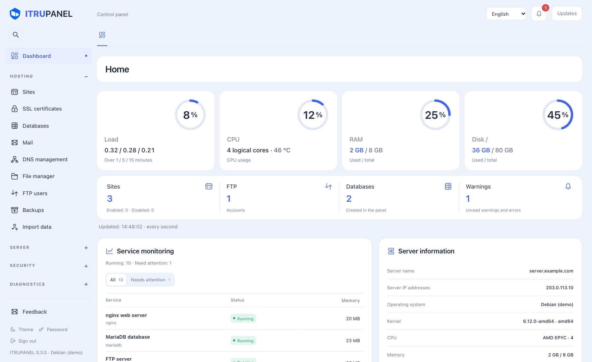
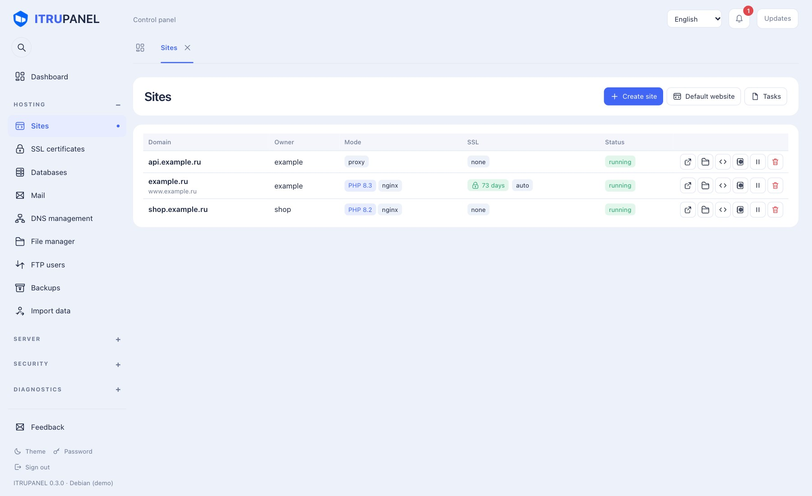
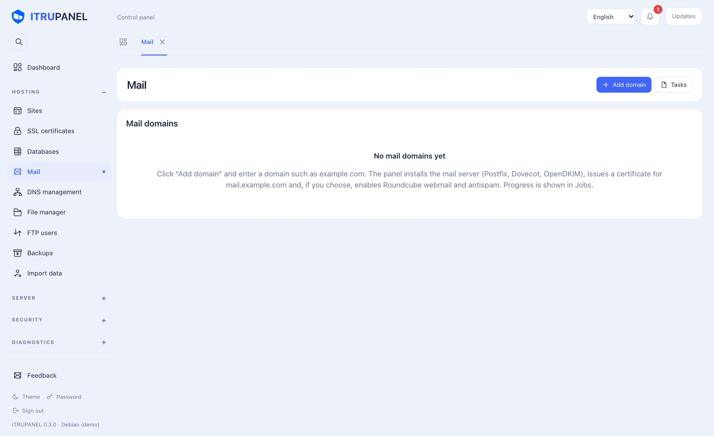
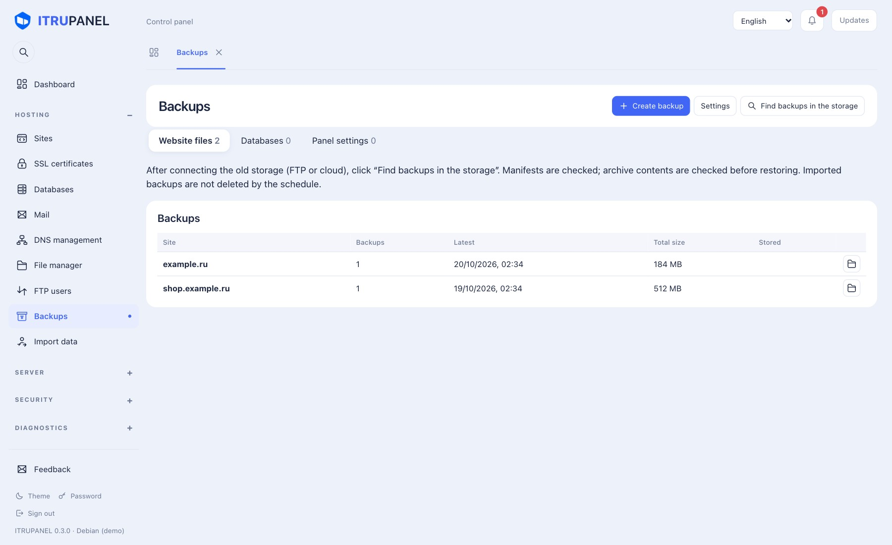
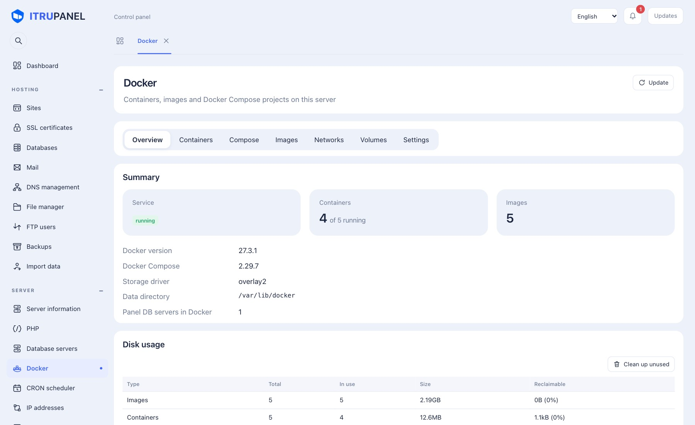
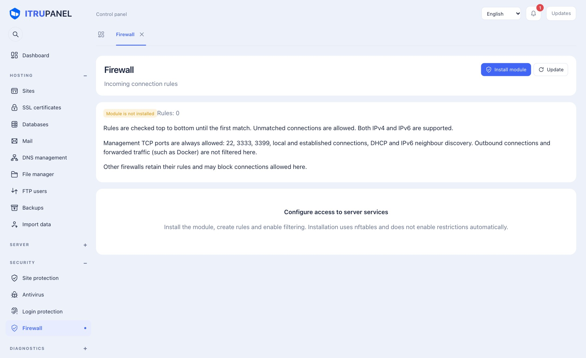
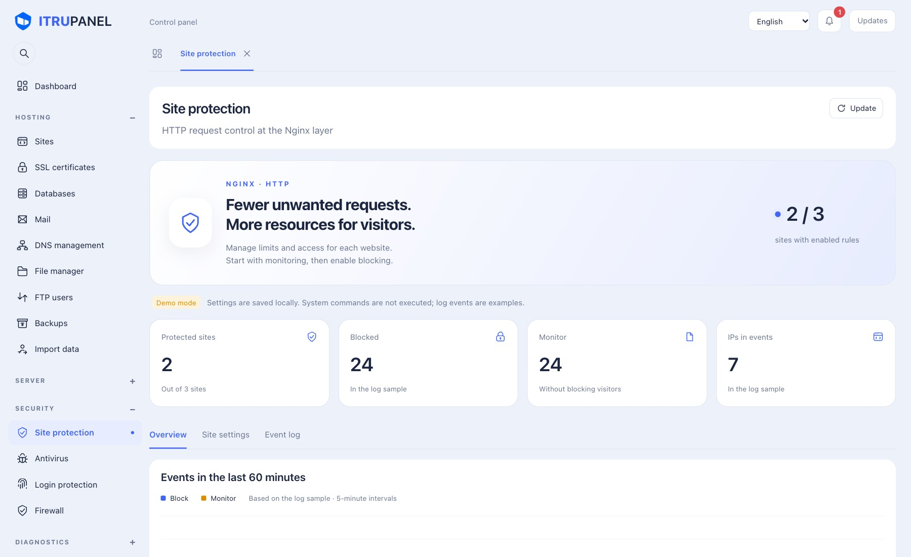
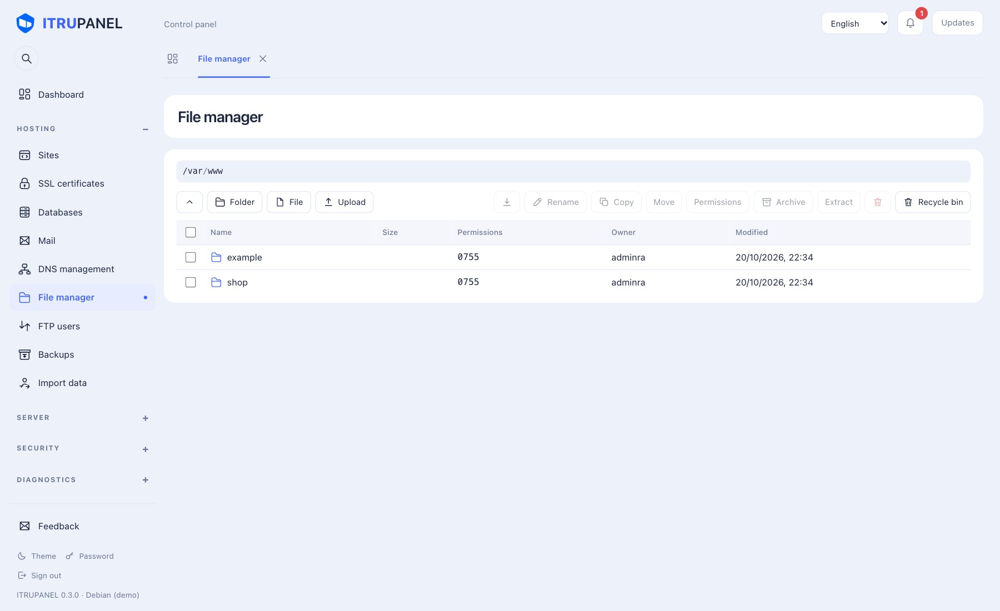
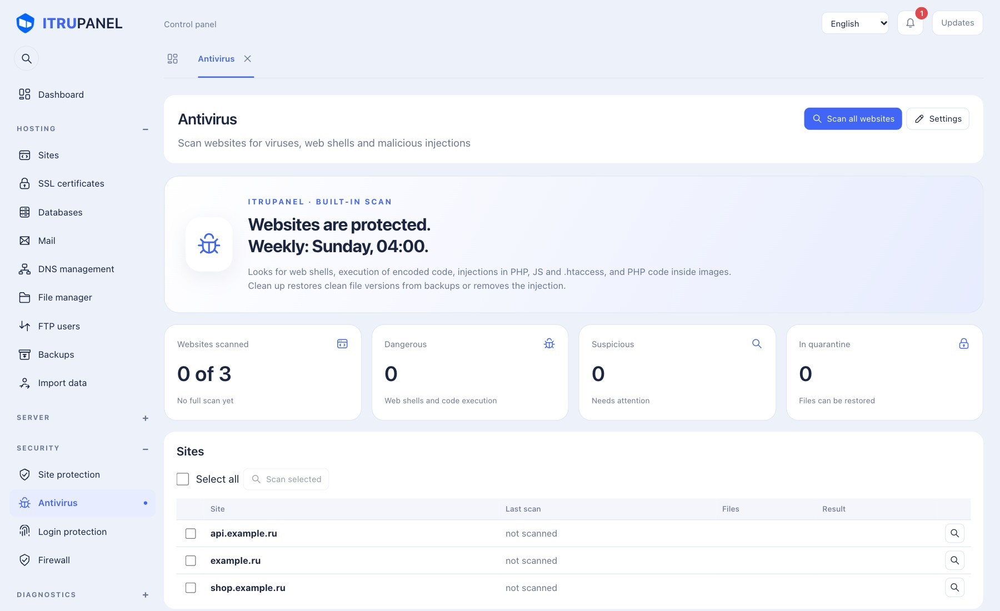

<p align="center">
  
</p>

<h1 align="center">ITRUPANEL</h1>

<p align="center"><b>A free, open-source control panel for servers and web hosting.</b><br>
Websites, PHP, databases, mail, DNS, SSL, FTP, backups, Docker, antivirus and firewall in one fast web interface.<br>
English and Russian · a single Go binary · amd64 and arm64</p>

<p align="center">
  <a href="https://github.com/ITRUpro/ITRUPANEL/releases/latest"></a>
  <a href="LICENSE.txt"></a>
  <a href="https://github.com/ITRUpro/ITRUPANEL/actions/workflows/ci.yml"></a>
  
</p>

<p align="center">
  <a href="https://itrupanel.com/">Website</a> ·
  <a href="https://itrupanel.com/en/docs.html">Documentation</a> ·
  <a href="https://itrupanel.com/en/#demo">Demo</a> ·
  <a href="https://itrupanel.com/forum/">Forum</a> ·
  <a href="README.ru.md">Русский</a>
</p>

---

## Welcome

**ITRUPANEL** turns a clean Linux server into a hosting platform. Every website gets its own system user and its own PHP-FPM
pool, so sites are isolated from each other. Everything is managed from the browser, in English or Russian, in a light or dark
theme. The panel is a single Go binary with the interface embedded; nothing but the panel itself has to be installed first.

The panel is **free for personal and commercial use**, including hosting for your own customers, and is released under the
[GNU GPL v3](LICENSE.txt).

## Screenshots

<table>
  <tr>
    <td width="50%"><br><sub><b>Sites</b> — Nginx, PHP-FPM, proxy, SSL status</sub></td>
    <td width="50%"><br><sub><b>Mail</b> — Postfix, Dovecot, DKIM, Roundcube</sub></td>
  </tr>
  <tr>
    <td width="50%"><br><sub><b>Backups</b> — server, FTP and S3 cloud storage</sub></td>
    <td width="50%"><br><sub><b>Docker</b> — containers, Compose, images</sub></td>
  </tr>
  <tr>
    <td width="50%"><br><sub><b>Firewall</b> — rules by port, protocol and address</sub></td>
    <td width="50%"><br><sub><b>Site protection</b> — request limits per site</sub></td>
  </tr>
  <tr>
    <td width="50%"><br><sub><b>File manager</b> — code editor, recycle bin</sub></td>
    <td width="50%"><br><sub><b>Antivirus</b> — scan, quarantine, cleanup</sub></td>
  </tr>
</table>

## Features and services

| Area | What you get |
| --- | --- |
| **Websites** | Nginx + PHP-FPM, static sites, reverse proxy, per-site system user and PHP version, aliases, Cyrillic domains, redirects, gzip, site types and templates (WordPress, Laravel, Joomla, 1C-Bitrix, SPA, a signed library and your own), page cache, PHP load profiles, protection checkboxes (headers, hotlink, site password, admin by IP), custom Nginx directives, default site, optional Apache or OpenLiteSpeed backend |
| **PHP** | Several PHP versions side by side, about 30 extensions you can install, turn off or remove (including ionCube Loader), `php.ini` editor |
| **Databases** | MariaDB databases and users, phpMyAdmin, dump import and export, per-IP access, extra MySQL/MariaDB servers in Docker |
| **Mail** | Postfix, Dovecot, OpenDKIM, Rspamd antispam with greylisting and DNSBL controls, Roundcube webmail, quotas, aliases, forwarding, DNS checks |
| **DNS and SSL** | BIND zones and records, Let’s Encrypt with automatic issue and renewal, self-signed and custom certificates |
| **Files and FTP** | Browser file manager with a code editor (syntax highlighting, find and replace), recycle bin, Pure-FTPd users |
| **Backups** | Files, databases and settings; full and incremental chains; stored on the server, on FTP or in the cloud — Yandex Disk, Mail.ru Cloud, Dropbox, Google Drive, any WebDAV (Nextcloud, ownCloud) or any S3-compatible storage (Amazon S3, Yandex Object Storage, Cloudflare R2, Wasabi, DigitalOcean Spaces, MinIO), alone or together with the server; browse a backup and restore only what you need |
| **Import** | Move websites, databases, mail (messages and passwords included), DNS zones, FTP users, cron jobs and backup settings from another ITRUPANEL server using only its address and administrator login; from **FASTPANEL** over SSH (websites, databases and FTP and mail users with their old passwords, mail messages, cron); from any other server over SSH (websites, databases, cron) |
| **Docker** | Containers, Compose projects, images, networks, volumes, cleanup |
| **Security** | Per-site request limits, login protection with Fail2ban for FTP, two-step authentication (TOTP) and access to the panel only from selected IP addresses, incoming-connection firewall, antivirus with optional ClamAV, quarantine and cleanup from backups |
| **Monitoring** | Dashboard, resource history, traffic per site, disk usage, site logs, operations log, background tasks, notifications |
| **Administration** | Browser root terminal, cron scheduler, server reboot, one-click panel updates with signed releases, optional automatic updates (off by default) |

Every section is described in the [documentation](https://itrupanel.com/en/docs.html).

## Antivirus

The **Antivirus** section scans websites for web shells and malicious code and can clean infected files.

- **Built-in scan**, available right away without installing anything: web shells, execution of encoded code, malicious injections in PHP, JS and `.htaccess`, PHP code hidden in images and PHP files in upload folders. Commented-out code is not treated as a threat, long encoded strings are decoded to show what is inside, and the rules are tuned not to fire on ordinary WordPress, Joomla or Bitrix code
- **Updatable rules**: a pack of extra detection rules, signed with the release key, is downloaded once a day from this repository (`antivirus/rules.json`) and applied without restarting the panel; only signed, newer packs are accepted, and the **Update rules** button runs it on demand
- **ClamAV** (optional): a signature database scan; the databases (about 120 MB) are updated once a day, with a switch to trusted mirrors where the official server is unavailable
- **Maldet** (optional, Linux only): a third antivirus next to ClamAV — [Linux Malware Detect](https://github.com/rfxn/linux-malware-detect), a scanner for web shells and malicious scripts with about 45 thousand signatures; one button installs it, the panel turns off its own monitoring and cron jobs, updates the signatures every 4 hours (or on the **Update signatures** button) and runs it after the built-in scan and ClamAV; Maldet never changes files, quarantine and cleanup stay with the panel
- **Cleanup from backups**: for every infected file the panel finds the last clean version in your backups and restores only that file; if there is none, the malicious injection is cut out and planted files go to quarantine. A plan is shown before any change
- **Quarantine**: previous versions of changed files are kept and can be brought back
- **Scan** all sites, one site or selected ones, manually or on a schedule (daily or weekly); the results show file, line, threat and severity, and notifications report findings
- **Gentle on weak servers**: scans never run at the same time (one at a time: scans, cleanup and database and rule updates wait for each other), ClamAV runs with the lowest priority and is skipped on servers with less than 2 GB of memory, and the default schedule is Sunday at 04:00

Heuristics can produce false positives, so look at a finding before deleting a suspicious file.

## Supported platforms

| Family | Versions |
| --- | --- |
| Ubuntu | 22.04, 24.04, 26.04 |
| Debian | 11, 12, 13 |
| AlmaLinux, Rocky Linux | 8, 9, 10 |
| CentOS Stream, RHEL | 9–10, 8–10 |
| FreeBSD (beta, separate archive) | 14, 15 |

FreeBSD (beta) has its own archive, installer and update channel; what works and what differs from Linux is described in [docs/FreeBSD.md](docs/FreeBSD.md).

amd64 and arm64 · root access and systemd are required · install on a clean server.

## Installing

Run as root on the new server:

```bash
wget -O install.sh https://itrupanel.com/panel/install-itrupanel.sh && bash install.sh
```

The installer downloads the release, verifies its checksum and signature, sets up Nginx, PHP-FPM, MariaDB, FTP and DNS and
prints the panel address with a **random administrator login and password**. Open `https://SERVER_IP:3333` and sign in.

Optional settings:

```bash
PANEL_LOGIN=name PANEL_PASSWORD=password bash install.sh   # choose your own login and password
PHP_VERSION=8.4 bash install.sh                            # PHP version to install
PHP_VERSION=none bash install.sh                           # do not install PHP
```

The login and password can be changed later in the panel (key icon) or with `itrupanel passwd <password> [login]`.

Ports: panel TCP 3333 · websites 80/443 · FTP 21 and passive 30000–30100 · DNS 53 (if used) · mail 25/587/993 (if mail is enabled).

**FreeBSD 14/15 (beta)** has its own installer and archive. Run as root on a clean FreeBSD server:

```sh
fetch -o install.sh https://itrupanel.com/panel/install-itrupanel-freebsd.sh && sh install.sh
```

What works and what differs from Linux: [docs/FreeBSD.md](docs/FreeBSD.md).

## Upgrading

The same installer command updates an installed panel and keeps a backup of the program and its settings. Releases are full
archives with a SHA-256 checksum and an Ed25519 signature that the installer and the panel verify before updating. You can also
update from the **Updates** button inside the panel.

## Moving from another server

On the new server open **Import data**, choose where you are moving from and what to move:

- **ITRUPANEL** — enter the address and administrator login of the old panel;
- **FASTPANEL** — enter the server address and root (or sudo) access over SSH; the panel reads the lists from FASTPANEL itself and moves websites, databases, FTP users, mail with messages and cron jobs, keeping the old passwords;
- **other server over SSH** (ISPmanager, HestiaCP, aaPanel and others) — websites, databases and cron jobs.

Missing PHP versions are installed automatically; the import works between Debian, Ubuntu, AlmaLinux and Rocky Linux.

## Building from source

You need Go (the version in `go.mod`) and Node.js 20 or newer.

```bash
git clone https://github.com/ITRUpro/ITRUPANEL.git
cd ITRUPANEL
./build.sh                # bin/itrupanel-linux-amd64 and bin/itrupanel-linux-arm64
go test ./...             # unit tests
```

Try the interface locally without touching your system — system commands are not executed in demo mode:

```bash
go run ./src -demo -http -listen 127.0.0.1:3399
```

The interface is plain JavaScript in `src/web/`; English text lives in `src/i18n/`. The code editor is a CodeMirror 6 bundle built from
`tools/codemirror`.

## Issues and support

- Found a bug or have an idea? Open an [issue](https://github.com/ITRUpro/ITRUPANEL/issues) with your OS, panel version and the exact error text.
- Questions and discussion: the [forum](https://itrupanel.com/forum/).
- Security problems: please read [SECURITY.md](SECURITY.md) and do not report them in public issues.

## Contributing

Pull requests are welcome — see [CONTRIBUTING.md](CONTRIBUTING.md). New interface text needs an English translation in
`src/i18n/en-ui.json` (the build fails without it) and new features should be described in `release/docs-src.py`.

## Copyright and license

Copyright (c) 2026 Oleg Sergeevich Dmitriev (Дмитриев Олег Сергеевич). ITRUPANEL.

ITRUPANEL is free software released under the [GNU General Public License v3.0](LICENSE.txt) (`GPL-3.0-only`).
See also [NOTICE.txt](NOTICE.txt) and the licenses of bundled third-party components in
[THIRD-PARTY-NOTICES.txt](THIRD-PARTY-NOTICES.txt). The names ITRUPANEL and itrupanel.com and the logo are not licensed under the GPL.
